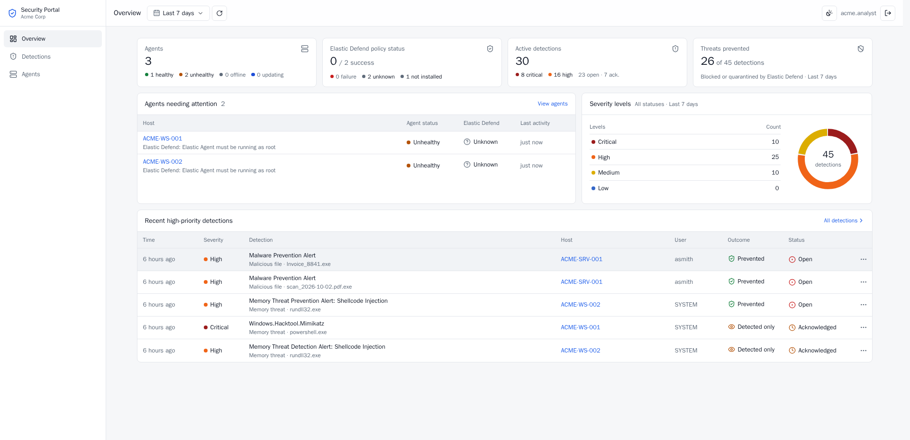
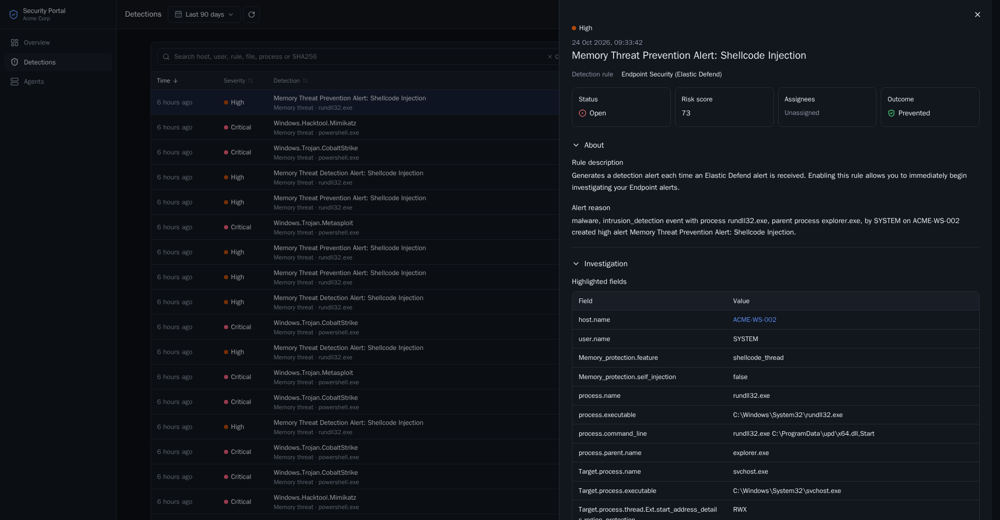
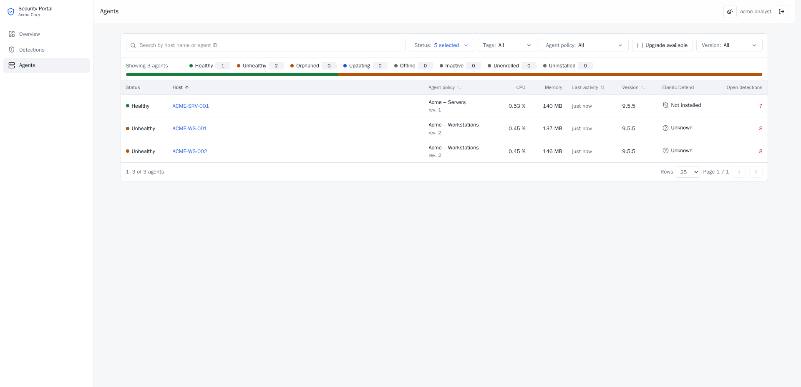
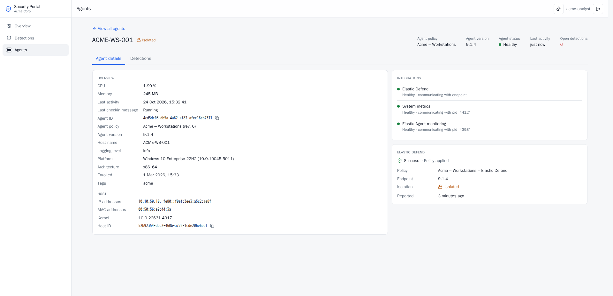

# MSSP Defend Portal

MSSP Defend Portal gives each customer of a shared Elastic cluster a read-only web portal
for their Fleet agents and Elastic Defend detections. Each portal serves one tenant, that
is one Kibana space and its data stream namespaces, and has three pages:

- **Overview:** agent health, Elastic Defend policy status, active detections, threats
  prevented and detections by severity, with the agents that need attention.
- **Detections:** the customer's Elastic Security alerts with severity, outcome
  (prevented or detected), investigation status and closing reason, and a details panel
  modelled on Kibana's alert flyout.
- **Agents:** a Fleet-style agent list and agent page with Elastic Defend policy status,
  network isolation, integration health and the agent's detections.

The portal is in English and German, using Kibana's German terms where Kibana has them. It
follows the browser's language until the user picks one in the top bar.

| Overview                                 | Detection details                            |
| ---------------------------------------- | -------------------------------------------- |
|  |  |

| Agents                                 | Agent details                         |
| -------------------------------------- | ------------------------------------- |
|  |  |

## How customers are kept apart

Each customer gets its own container, configured with that customer's Kibana space, agent
policies and data stream namespaces, and its own read-only API key. Elasticsearch limits
the key to the customer's data with document-level security. The portal also filters its
queries by space, namespace and agent policy, rejects documents from other customers, and
passes on only the fields it shows, such as the highlighted fields of each detection type.
[docs/ARCHITECTURE.md](docs/ARCHITECTURE.md) describes the design in detail.

## Requirements

- Elastic Stack 9.4 or later with Elastic Security and space-aware Fleet. Verified with 9.5.5.
- Per customer: a Kibana space, the customer's agent policies in that space, and a data
  stream namespace of its own, set on those agent policies. Using the space id as the
  namespace keeps it simple.
- The prebuilt **Endpoint Security (Elastic Defend)** rule enabled in the customer's space,
  which turns Elastic Defend alerts into Elastic Security alerts, with the space's
  _Included data stream namespaces for rule execution_ set to the customer's namespace (see
  [Detection rules and spaces](docs/ELASTIC.md#detection-rules-and-spaces)).
- Docker or Kubernetes to run the container.

## Setting up a customer

The steps use a customer `contoso` with the space and namespace `contoso` and one agent
policy. Fleet gives a policy created in Kibana a UUID as its id; it is the last part of the
policy's URL in Fleet and the `id` in `GET /api/fleet/agent_policies`. A policy created
through the Fleet API can be given a readable id instead.

1. **Create the customer's API key** with the request in
   [docs/ELASTIC.md](docs/ELASTIC.md#per-tenant-api-key), and save the `encoded` value as
   `secrets/contoso/elastic_api_key`.
2. **Create a session secret** of at least 32 characters:

   ```bash
   openssl rand -base64 48 > secrets/contoso/session_secret
   ```

3. **Create the users file.** Hash each password:

   ```bash
   docker run --rm -it -v "$PWD/scripts:/s:ro" node:24.22.1-alpine node /s/hash-password.mjs
   ```

   and list the users in `secrets/contoso/users.json`:

   ```json
   { "jane.doe": "scrypt$…" }
   ```

   The container runs as uid 1000, which must be able to read these files.

4. **Build the image** once for all customers:

   ```bash
   docker build -t mssp-defend-portal .
   ```

   The build also runs the type check and the tests. Alternatively, use the published
   `ghcr.io/zu3st/mssp-defend-portal` image (see [Releases](#releases)).

5. **Run the customer's container:**

   ```bash
   docker run -d --name portal-contoso --read-only --tmpfs /tmp --cap-drop ALL \
     --security-opt no-new-privileges -p 127.0.0.1:3201:3000 \
     -v "$PWD/secrets/contoso:/run/secrets:ro" \
     -e TENANT_ID=contoso -e TENANT_NAME='Contoso Ltd' \
     -e TENANT_AGENT_POLICY_IDS=4f9c2b1e-7d3a-4c8e-9b6f-2a1d5e8c7f30 -e TENANT_NAMESPACES=contoso \
     -e DATA_SOURCE=elastic \
     -e ELASTICSEARCH_URL=https://elasticsearch.example:9200 \
     -e KIBANA_URL=https://kibana.example:5601 \
     -e ELASTIC_API_KEY_FILE=/run/secrets/elastic_api_key \
     -e SESSION_SECRET_FILE=/run/secrets/session_secret \
     -e PORTAL_USERS_FILE=/run/secrets/users.json \
     -e ORIGIN=https://portal.contoso.example \
     mssp-defend-portal
   ```

6. **Publish it over TLS** through a reverse proxy or ingress at the `ORIGIN` address.

Sign-in uses the local users file; single sign-on is not built in yet.
[docs/PRODUCTION.md](docs/PRODUCTION.md) describes the options and what else to check
before going live.

## Configuration

| Variable                             | Required     | Meaning                                                                                                 |
| ------------------------------------ | ------------ | ------------------------------------------------------------------------------------------------------- |
| `TENANT_ID`                          | yes          | Portal tenant id; sessions are bound to it                                                              |
| `TENANT_NAME`                        | –            | Display name                                                                                            |
| `KIBANA_SPACE_ID`                    | –            | Customer's Kibana space (default: `TENANT_ID`)                                                          |
| `TENANT_AGENT_POLICY_IDS`            | yes          | Comma-separated Fleet agent policy ids (UUIDs unless set via the API)                                   |
| `TENANT_NAMESPACES`                  | yes          | Data stream namespaces of this customer's policies                                                      |
| `ALERTS_INDEX`                       | –            | Default `.alerts-security.alerts-<space>`                                                               |
| `DATA_SOURCE`                        | –            | `mock` (default) or `elastic`                                                                           |
| `ELASTICSEARCH_URL`, `KIBANA_URL`    | elastic      | Elasticsearch and Kibana URLs as the container reaches them                                             |
| `ELASTIC_API_KEY[_FILE]`             | elastic      | Tenant-specific read-only API key (encoded form)                                                        |
| `ELASTIC_TIMEOUT_MS`                 | –            | Timeout of each Elastic request, default 10000                                                          |
| `NODE_EXTRA_CA_CERTS`                | –            | CA bundle for the Elastic TLS certificates                                                              |
| `SESSION_SECRET[_FILE]`              | yes          | At least 32 characters; unique per container                                                            |
| `PORTAL_USERS_FILE` / `PORTAL_USERS` | yes          | JSON `{user: scryptHash}` / `user:hash,…`                                                               |
| `ORIGIN`                             | recommended  | Public origin(s), comma-separated, e.g. `https://portal.acme.example`; POSTs must come from one of them |
| `COOKIE_SECURE`                      | –            | `true` by default; `false` only for local testing over plain HTTP                                       |
| `SESSION_TTL_SECONDS`                | –            | Default 8 hours                                                                                         |
| `ADDRESS_HEADER`, `XFF_DEPTH`        | behind proxy | Where the proxy puts the client IP, e.g. `X-Forwarded-For`; failed logins are limited per client IP     |

`/healthz` reports that the portal runs and `/readyz` that it reaches Kibana; both work
without a login, for health probes.

## Trying it out

The portal runs on generated, Elastic-shaped data without an Elastic stack. This starts
two customers, `acme` and `globex`:

```bash
./scripts/lab-init.sh
```

```bash
docker compose up -d --build
```

The first command creates a session secret and a demo user per customer and prints the
passwords once. The Acme portal is then on <http://localhost:3101> (user `acme.analyst`)
and the Globex portal on <http://localhost:3102> (user `globex.analyst`).

The project also has its own Elastic 9.5.5 lab stack in `lab/`. Start it as described in
[docs/LAB.md](docs/LAB.md), then connect the portals to it:

```bash
docker compose -f compose.yaml -f compose.elastic.yaml up -d --build
```

`scripts/e2e-lab.sh` runs tenant isolation and read-only checks over HTTP against the two
running portals:

```bash
A_USER=acme.analyst A_PASS='…' B_USER=globex.analyst B_PASS='…' ./scripts/e2e-lab.sh
```

## Releases

Every push to `main` runs [release.yml](.github/workflows/release.yml): it builds the
image (including the type check and the tests) and publishes
`ghcr.io/zu3st/mssp-defend-portal` as `latest` and `sha-<commit>`, with an SBOM and a
provenance attestation. To check an image:

```bash
gh attestation verify oci://ghcr.io/zu3st/mssp-defend-portal@sha256:<digest> --owner zu3st
```

## Development

Everything runs in Docker; Node is not needed on the host.

```bash
docker run --rm -it -u "$(id -u):$(id -g)" -e HOME=/tmp -v "$PWD":/app -w /app node:24.22.1-alpine npm ci
```

```bash
docker run --rm -u "$(id -u):$(id -g)" -e HOME=/tmp -v "$PWD":/app -w /app node:24.22.1-alpine sh -c 'npm run check && npm test'
```

```bash
docker run --rm -it -u "$(id -u):$(id -g)" -e HOME=/tmp -v "$PWD":/app -v "$PWD/secrets/acme:/run/secrets:ro" --env-file .env.example -e COOKIE_SECURE=false -p 5173:5173 -w /app node:24.22.1-alpine npx vite dev --host 0.0.0.0
```

The commands install the dependencies, run the type check and the tests, and start a
development server for the `acme` customer with generated data on <http://localhost:5173>.

## Repository layout

- `src/routes/`: pages (overview, detections, agents, login) and the alert details API
- `src/lib/components/`: UI components
- `src/lib/server/`: configuration, authentication, tenant scoping (`portal.ts`) and URL
  parameter parsing
- `src/lib/server/elastic/`: read-only Elastic client and queries
- `src/lib/server/normalize/`: Elastic documents to the portal's data contract
- `src/lib/server/mock/`: generated Elastic-shaped data for several customers
- `lab/`: Elastic lab stack, tenant setup and alert feeder
- `scripts/`: lab secrets, password hashing and HTTP checks
- `.github/workflows/`: container build and publishing
- `docs/`: architecture, Elastic APIs and privileges, lab, dependencies, production
  readiness

## Documentation

- [Architecture, tenant isolation and authentication](docs/ARCHITECTURE.md)
- [Elastic APIs, fields, privileges and verification](docs/ELASTIC.md)
- [Lab stack and real Elastic Defend host](docs/LAB.md)
- [Dependencies and why they are trusted](docs/DEPENDENCIES.md)
- [Known limitations and production readiness](docs/PRODUCTION.md)
